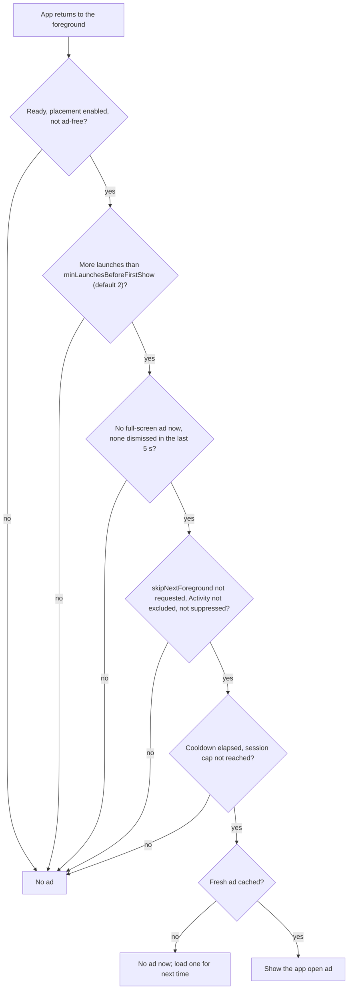

# App open ads

## When to use them

An app open ad shows when the user brings your app back to the foreground, or on a cold start from your loading
screen ([Google](https://developers.google.com/admob/android/next-gen/app-open),
[app open guidance](https://support.google.com/admob/answer/9341964)).

## How the library decides

After `Ready`, the library preloads the app open placement. Each time the app returns to the foreground (not on the
process's first start), it shows the ad only if every gate passes:



It never waits for an ad on a warm start: showing late would surprise the user.

## Cold start: from your loading screen only

Google advises showing app open ads on cold starts only from a loading screen, and not on the very first start. Call
`showOnColdStart` from that screen; exclude the screen from automatic app open ads
(`appOpen(…) { excludeActivities(SplashActivity::class.java) }`):

<!-- snippet: docs-snippets/src/main/kotlin/com/company/admob/docs/FullScreen.kt#app-open-cold-start -->
```kotlin
class SplashActivity : AppCompatActivity() {
    override fun onCreate(savedInstanceState: Bundle?) {
        super.onCreate(savedInstanceState)
        CompanyAdMob.start(this) {
            // Waits up to 4 s for an app open ad, shows it if one is ready, then continues whatever happened.
            CompanyAdMob.appOpen.showOnColdStart(this, maxWait = 4.seconds) { goToMain() }
        }
    }

    private fun goToMain() {
        if (isFinishing) return
        startActivity(Intent(this, LauncherActivity::class.java))
        finish()
    }
}
```

`onComplete` is called exactly once: after the ad is dismissed, or right away when there's no ad within `maxWait`
(the ad is then kept for the next foreground). If the Activity is paused or destroyed while waiting (for example, on
rotation), the result is `NotShown(ActivityUnavailable)`; the recreated screen may call again.

## Controls

<!-- snippet: docs-snippets/src/main/kotlin/com/company/admob/docs/FullScreen.kt#app-open-controls -->
```kotlin
fun openSharesheet(activity: Activity, share: Intent) {
    // Returning from the share sheet mustn't show an app open ad.
    CompanyAdMob.appOpen.skipNextForeground()
    activity.startActivity(Intent.createChooser(share, null))
}

class CheckoutActivity : AppCompatActivity() {
    override fun onCreate(savedInstanceState: Bundle?) {
        super.onCreate(savedInstanceState)
        // No app open ad while this screen is at least STARTED; released automatically when it's destroyed.
        CompanyAdMob.appOpen.suppressWhile(this)
    }
}

fun onUserBoughtPremium() {
    CompanyAdMob.appOpen.setEnabled(false) // or CompanyAdMob.setAdFree(true) to stop every format
}
```

Call `skipNextForeground()` before anything that leaves the app on purpose: purchases, share sheets, pickers, sign-in,
the camera, permission settings.

## State, events, errors

- `appOpen.availability` reports the cached ad.
- Events and errors are the same as [interstitials](INTERSTITIAL.md).
- A cached app open ad expires after 3 h 55 min, before Google's four-hour limit.
- Failed loads retry after 10 s, doubling up to 300 s, 3 attempts.

## FAQ

**No app open ad in testing.** It never shows on the first two launches (`minLaunchesBeforeFirstShow`), nor within
4 minutes of the last one (`cooldown`), nor over an excluded Activity. Background the app (Home), wait, and come back.
See [Troubleshooting](TROUBLESHOOTING.md).

**It showed after the user came back from a purchase.** Call `skipNextForeground()` before starting the purchase flow.

Last verified against: ads-mobile-sdk 1.4.0, UMP 4.0.0, 2026-09-26
