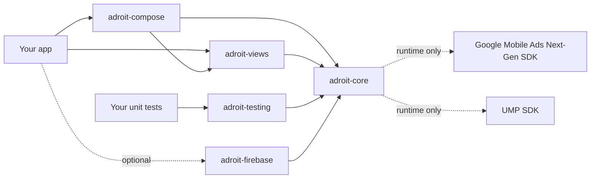
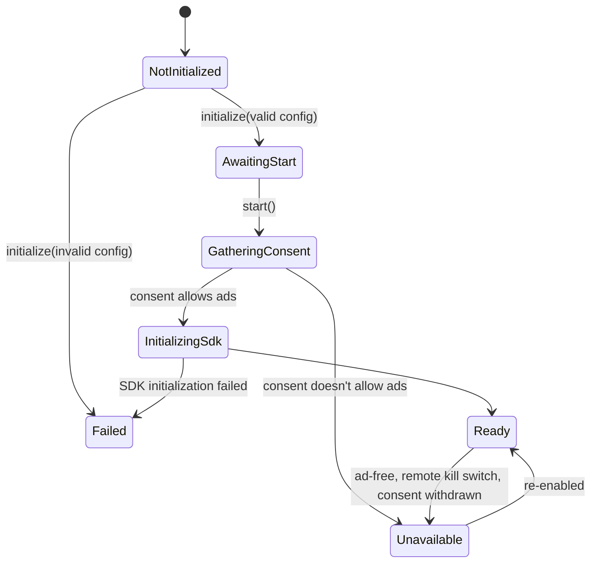

# How Adroit works

A short tour for app developers. The full design, with every decision record, is in
[architecture/02_ARCHITECTURE.md](architecture/02_ARCHITECTURE.md); the public API specification is in
[architecture/03_PUBLIC_API.md](architecture/03_PUBLIC_API.md).

## Modules

- **adroit-core** holds everything that matters: configuration, consent, initialization, every format's loading,
  caching, retry, expiry and frequency logic, events and diagnostics. Only its `internal.google` package talks to
  Google's SDKs, so no Google type appears in the API and a Google SDK upgrade stays inside the library.
- **adroit-views** and **adroit-compose** are thin UI adapters on top of core's public API.
- **adroit-testing** replaces core with a fake for your unit tests.
- **adroit-firebase** (optional) connects Firebase Remote Config and Analytics; the only module that depends on Firebase.

## Two-step startup

`initialize(application, config)` in `Application.onCreate` validates the configuration and attaches lifecycle
observers. It's cheap and makes no network or Google SDK call. `start(activity)` then gathers consent and initializes
the Google SDK, because UMP needs an Activity to show its form.

`Adroit.state` (a `StateFlow<AdsState>`) is the single source of truth. **No ad is requested unless the state
is `Ready`**. Calls made earlier are remembered as intent: a banner created before `Ready` loads when it gets there.

## What the library does for every ad

- **Preloading:** full-screen placements load after `Ready` (strategy `AFTER_READY`), and reload after each show.
- **Retry:** failed loads retry with exponential backoff and jitter; a no-fill waits at least 30 seconds. Retries
  pause without a network and run as soon as it returns.
- **Expiry:** cached ads are dropped a few minutes before Google's limits (55 minutes; 3 h 55 min for app open).
- **Frequency:** per-placement minimum interval and session cap, a global interval between full-screen ads, and
  app open cooldown. These are a user-experience safeguard, not a replacement for AdMob's own frequency capping.
- **One full-screen ad at a time**, across every format.
- **Every show calls you back exactly once**, on the main thread, never synchronously, including when nothing was
  shown. Rewards carry a `rewardId` for exactly-once granting.
- **Lifecycle:** banners and native ads are destroyed with the lifecycle owner you give them; nothing holds your
  Activity after it's destroyed.
- **Threading:** `initialize`, `start`, the `show` and `preload` calls and the other non-UI calls work from any thread
  (they move to the main thread). Calls that create or render views (banners, native rendering, the views and Compose
  helpers) are main-thread only. Callbacks and state changes always arrive on the main thread.

## Where to go next

[Getting started](GETTING_STARTED.md) · [Configuration](CONFIGURATION.md) · [Consent](CONSENT.md) ·
[Troubleshooting](TROUBLESHOOTING.md)

Last verified against: ads-mobile-sdk 1.4.0, UMP 4.0.0, 2026-09-28
