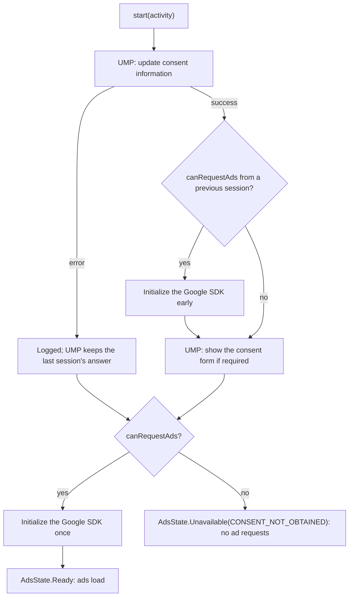

# Consent and privacy

CompanyAdMob gathers consent with Google's User Messaging Platform (UMP) **before** any ad request, as Google
requires ([UMP for Next-Gen](https://developers.google.com/admob/android/next-gen/privacy)).

CompanyAdMob follows Google's documented requirements as of 2026-09-26. Your app remains responsible for its own
policy configuration and product usage: which messages you publish in AdMob, your age treatment, your privacy policy
and your Play data safety form.

## The flow



## What the library does, and what it doesn't

It does:
- request consent information and show the form when UMP says it's required, on every `start()`;
- block every ad request until `canRequestAds` is true;
- expose the state as `CompanyAdMob.privacy.consentState` and `isPrivacyOptionsRequired`;
- show the privacy options form with `privacy.showPrivacyOptions(activity)`;
- apply age treatment, max ad content rating and restricted data processing to every request.

It doesn't:
- create your consent messages: that's done in the AdMob UI;
- show a privacy options button: your settings screen must, when required (below);
- decide your age treatment, or fill in your Play data safety form.

## Set up messages in the AdMob UI

In AdMob, open **Privacy & messaging** and create:
- a **European regulations** message (GDPR, for the EEA, the UK and Switzerland):
  [how to create it](https://support.google.com/admob/answer/10113207);
- a **US state regulations** message, if you serve users in those states:
  [US states privacy](https://developers.google.com/admob/android/next-gen/privacy/us-states).

If you use mediation, add your mediation partners to these messages too, or they can't serve ads
([mediation setup](https://developers.google.com/admob/android/next-gen/mediation)).

Without a published message, UMP never shows a form, and consent stays as UMP decides by default.

## The privacy options entry point

Some messages require your app to offer a way back to the consent choices
([Google](https://developers.google.com/admob/android/next-gen/privacy)). Show a "Privacy options" button in your
settings while `isPrivacyOptionsRequired` is true:

<!-- snippet: docs-snippets/src/main/kotlin/com/company/admob/docs/Consent.kt#privacy-button-views -->
```kotlin
class SettingsActivity : AppCompatActivity() {
    override fun onCreate(savedInstanceState: Bundle?) {
        super.onCreate(savedInstanceState)
        val privacyButton = Button(this).apply { text = "Privacy options" }
        setContentView(privacyButton)

        privacyButton.setOnClickListener {
            CompanyAdMob.privacy.showPrivacyOptions(this) { error ->
                if (error != null) Toast.makeText(this, error.message, Toast.LENGTH_SHORT).show()
            }
        }
        // Shown only while UMP requires an entry point (for example, for users in the EEA).
        lifecycleScope.launch {
            repeatOnLifecycle(Lifecycle.State.STARTED) {
                CompanyAdMob.privacy.isPrivacyOptionsRequired.collect { privacyButton.isVisible = it }
            }
        }
    }
}
```

In Compose:

<!-- snippet: docs-snippets/src/main/kotlin/com/company/admob/docs/Consent.kt#privacy-button-compose -->
```kotlin
@Composable
fun PrivacyOptionsButton() {
    val required by CompanyAdMob.privacy.isPrivacyOptionsRequired.collectAsStateWithLifecycle()
    val activity = LocalActivity.current
    if (required && activity != null) {
        Button(onClick = { CompanyAdMob.privacy.showPrivacyOptions(activity) }) { Text("Privacy options") }
    }
}
```

When the user changes their choices, the library updates `consentState`. If ads are no longer allowed, the state
becomes `Unavailable(CONSENT_NOT_OBTAINED)` and caches are destroyed.

<!-- snippet: docs-snippets/src/main/kotlin/com/company/admob/docs/Consent.kt#consent-state -->
```kotlin
@Composable
fun ConsentStatusLine() {
    val consent by CompanyAdMob.privacy.consentState.collectAsStateWithLifecycle()
    Text("Consent: ${consent.status}, can request ads: ${consent.canRequestAds}")
}
```

## Testing consent

- **Debug geography:** `privacy { debugGeography = DebugGeography.EEA }` makes UMP behave as if the device were in the
  EEA. It works on test devices only, and is rejected in PRODUCTION.
- **Test devices:** UMP prints the device's hashed ID in Logcat after the first consent request, in a message
  containing `addTestDeviceHashedId("…")`. Add that ID to `testing { testDeviceIds += "…" }` (the same list also
  gives test ads).
- **Reset:** clear the stored consent to see the form again (debug builds only; Google says never in production):

<!-- snippet: docs-snippets/src/main/kotlin/com/company/admob/docs/Consent.kt#reset-consent -->
```kotlin
/** Debug builds only: forget the stored consent, so the next start() shows the form again. */
fun resetConsentForQa() {
    CompanyAdMob.privacy.resetConsentForTesting()
}
```

Then restart the app, so `start()` runs again.

## Age treatment and content rating

- `privacy { ageTreatment = AgeTreatment.CHILD }` (or `TEEN`) asks Google to apply the protections for that audience
  ([targeting](https://developers.google.com/admob/android/next-gen/targeting#set_the_age_treatment)). Choosing it
  correctly for your app, including Google Play Families rules, is your responsibility.
- Mediation adapters forward the age treatment only from certain versions:
  [minimum adapter versions](https://developers.google.com/admob/android/next-gen/targeting#forward-age-treatment-with-admob-mediation).
- `privacy { maxAdContentRating = MaxAdContentRating.PG }` limits ad content
  ([content filtering](https://developers.google.com/admob/android/next-gen/targeting#ad-content-filtering)).

## Restricted data processing (US states)

`privacy { restrictedDataProcessing = true }` enables restricted data processing on every request, for users who opt
out under US state privacy laws ([US states](https://developers.google.com/admob/android/next-gen/privacy/us-states)).
Read Google's page before combining it with a UMP US state regulations message.

## Consent Mode and Firebase

If the app also uses Google Analytics for Firebase, UMP 3.2.0 and newer (the library uses 4.0.0) can apply the
user's GDPR choices to Google Consent Mode for you. The library needs no code for this
([Consent mode](https://developers.google.com/admob/android/next-gen/privacy/consent-mode)):

1. Turn on consent mode in the AdMob UI.
2. Initialize Firebase **before** `CompanyAdMob.start()`, which starts UMP. The google-services plugin initializes it
   before `Application.onCreate`, so this holds unless you initialize Firebase manually later.
3. Set the default consent state yourself for users outside the EU regulations, as Google's page describes.

## Play data safety and the advertising ID

The Google Mobile Ads SDK collects data you must declare in Google Play's data safety form, including the advertising
ID ([Play data disclosure](https://developers.google.com/admob/android/next-gen/privacy/play-data-disclosure)).
Collecting the advertising ID is optional. An app that must not collect it (for example, one primarily for children,
under Google Play's Families policy) removes the permission in its manifest:

```xml
<uses-permission
    android:name="com.google.android.gms.permission.AD_ID"
    tools:node="remove" />
```

Last verified against: ads-mobile-sdk 1.4.0, UMP 4.0.0, 2026-09-26
