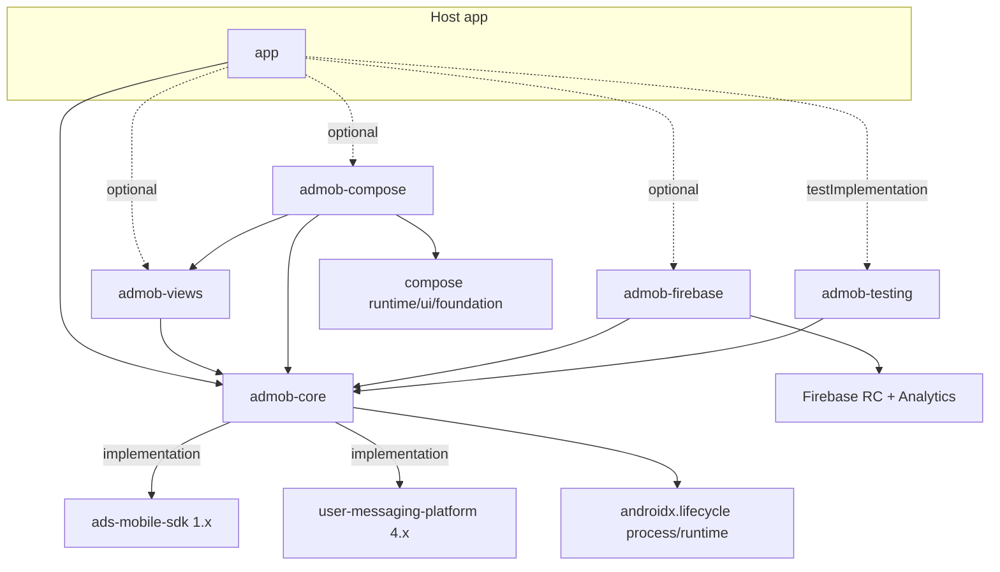
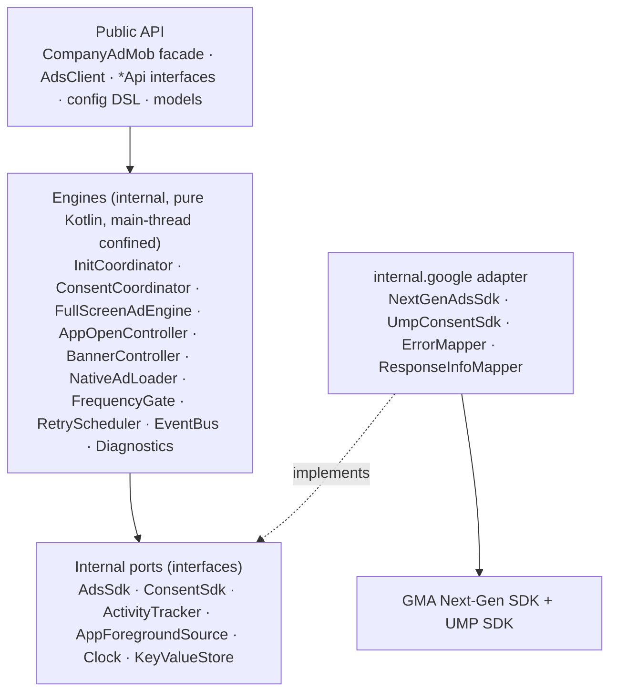
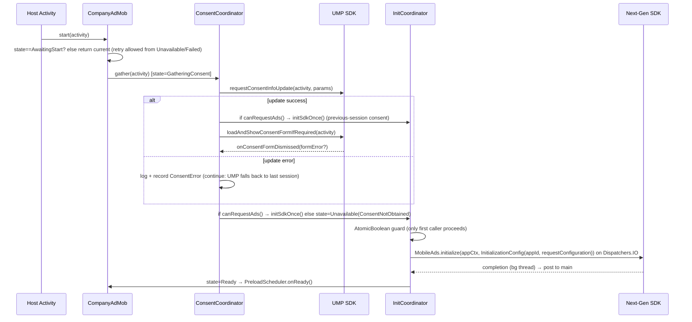
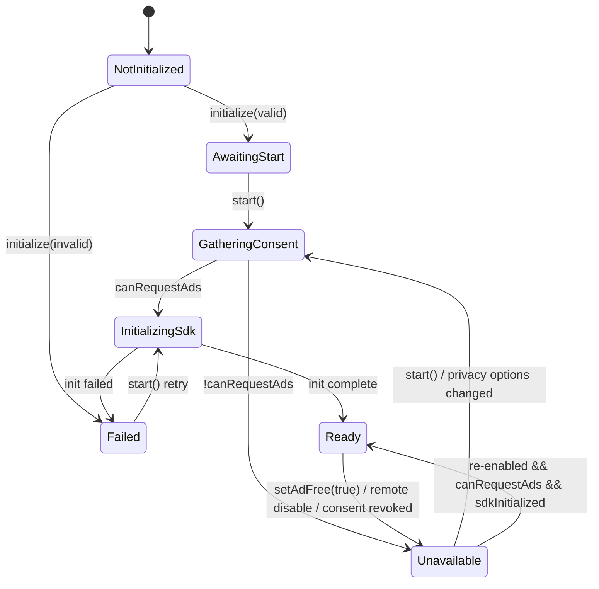
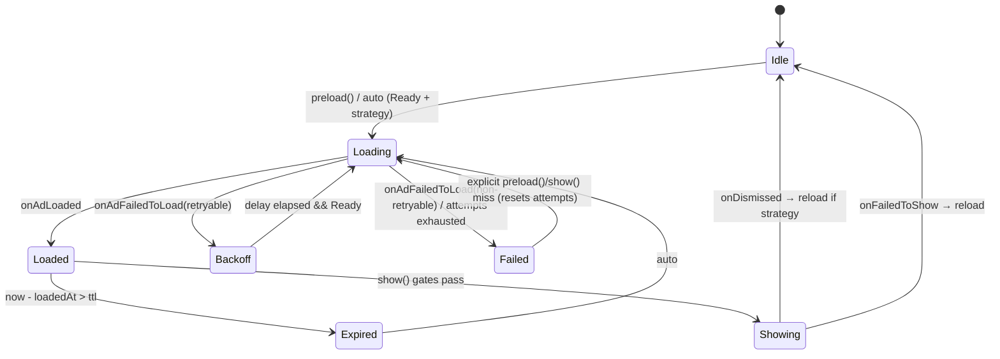
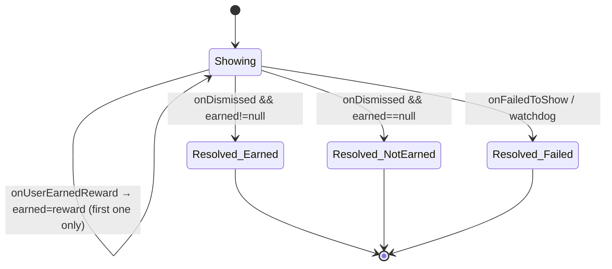
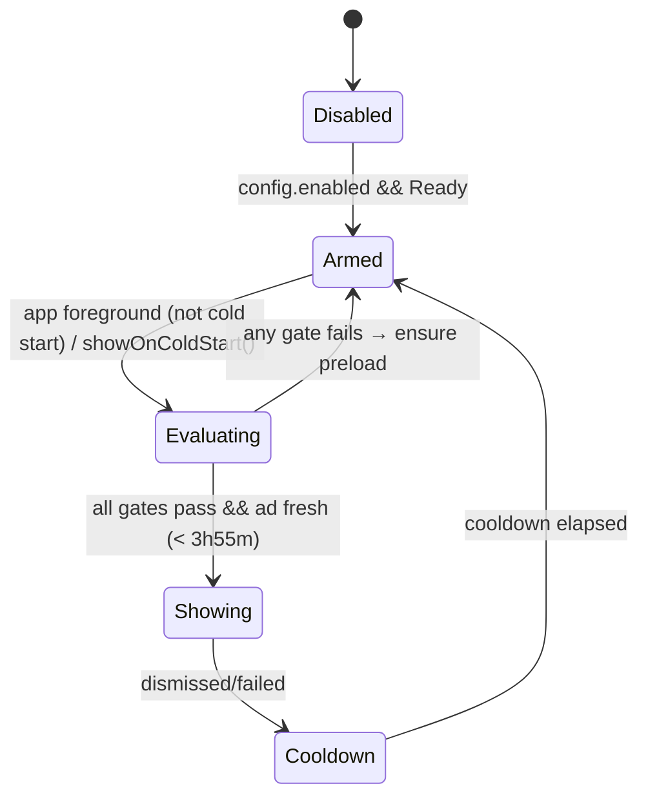

# Part 2: CompanyAdMob architecture

Status: **Approved design baseline, v0.1 (2026-09-25).** Changes to this document need an ADR entry in §32.
Research that backs this design: [01_SDK_RESEARCH.md](01_SDK_RESEARCH.md). Public API detail: [03_PUBLIC_API.md](03_PUBLIC_API.md).

Naming: `CompanyAdMob`, package `com.company.admob`, and Maven group `com.company` are **placeholders**. §20.4 describes the one-time rename.

Priority order for every decision: **correctness > maintainability > API stability > reliability > simplicity > convenience.**

---

## 1. Goals

1. One reusable Android library that any company app can integrate in under an hour, whether it's XML, Compose, mixed, Hilt, or non-Hilt.
2. A small, stable, Kotlin-first public API with **no Google SDK types**, except behind an explicit opt-in escape hatch.
3. Privacy first: no ad request is ever made before UMP consent handling is complete and `canRequestAds()` is true.
4. Failure first: ads never block the host app. Every show call ends with exactly one deterministic result.
5. Lifecycle-safe: no leaked Activities, no `BadTokenException`, and no duplicate shows.
6. Test ads by default outside production, and production misconfiguration is hard to ship.
7. Swapping the Google SDK (Next-Gen major versions, or a legacy adapter if ever needed) only changes internal adapter code.

## 2. Non-goals (v1)

- Other ad providers (AppLovin MAX as the primary SDK, IronSource, and so on). The adapter seam allows them later, but none are built now.
- Bundling mediation adapters. Host apps add the adapters they choose.
- Ad Manager-specific features (custom targeting, custom native formats, PPID) beyond pass-through extras.
- Picture-in-picture and swipeable interstitial (beta/private beta).
- Server-side reward verification backends. The library passes `customData` through for SSV; the host owns the server.
- Persistent analytics, databases, background services, WorkManager jobs, or DI frameworks.
- A pure-Compose native renderer that registers composables as asset views. The view-based renderer is bridged to Compose instead (§18).
- Guaranteeing policy compliance (see the policy statement in 01).

## 3. Requirements traceability (summary)

| Requirement | Where it's satisfied |
|---|---|
| XML, Compose, legacy, and modern apps | `admob-views`, `admob-compose`, core API works without either (§7) |
| Hilt / no Hilt | `AdsClient` interface plus the `CompanyAdMob` facade. No DI framework dependency (§9) |
| Firebase optional | `AdConfigProvider` and `AdEventListener` interfaces. Optional `admob-firebase` module (§21–22) |
| Multiple apps, multiple environments | `AdMobConfig` DSL, `AdEnvironment`, placement registry (§20) |
| Consent / UMP | `ConsentCoordinator` (§11, §30) |
| Lifecycle | `ActivityTracker`, `FullScreenCoordinator`, `AppOpenController`, lifecycle-bound banner and native handles (§12–19) |
| Preload / cache / expiry / retry | `FullScreenAdEngine` + `AdCache` + `RetryPolicy` (§12, §25) |
| Frequency / cooldown | `FrequencyGate` (§20.6) |
| Analytics / logging / diagnostics | `AdEvent` stream, `AdEventListener`, `AdLogger`, `AdDiagnostics` (§22–23) |
| API stability | explicit API mode, `apiCheck` (BCV dump engine), `@ExperimentalCompanyAdMobApi`, `@GoogleSdkEscapeHatch` (§31) |

## 4. SDK research (summary)

See 01. The key facts:
- The legacy SDK is in maintenance mode, and v24/v25 sunset on 2028-06-30.
- Next-Gen has been GA since 2026-04 (1.4.0 documented, 1.5.0 on Maven).
- Next-Gen initialization is mandatory, must run on a background thread, and delivers callbacks on background threads.
- UMP 4.0.0. App-open ads expire after 4 h. Other formats expire after about 1 h.

## 5. SDK version decision

- `com.google.android.libraries.ads.mobile.sdk:ads-mobile-sdk:1.4.0`, pinned in `gradle/libs.versions.toml`. It's declared as an **`implementation`** dependency of `admob-core` (never `api`). It still ends up on the consumer's runtime classpath, which it must, but its classes aren't on the consumer's compile classpath. That keeps Google types from leaking into host code by accident.
- UMP comes in transitively through Next-Gen. `admob-core` also declares `com.google.android.ump:user-messaging-platform:4.0.0` directly, because the library calls its API and relying on another artifact's transitive dependency for a direct call would be fragile.
- Toolchain (verified in Prompt 01): AGP 9.1.1 with built-in Kotlin. The Kotlin Gradle plugin is pinned to 2.4.20 through `build-logic`, overriding AGP's bundled 2.2.10. compileSdk 37 (installed, and required by the samples' `androidx.core` 1.19). **Library minSdk 24**, which Next-Gen requires. The library itself has **no targetSdk**; samples target 36. **JVM target 11**, the lowest Next-Gen supports, which maximises host compatibility and avoids the "cannot inline JVM 17 bytecode into 11" error in older hosts. **`languageVersion`/`apiVersion` = 2.2** and **`coreLibrariesVersion` = 2.2.0** (ADR-010). Kotlin 2.4 deprecates language version 2.1, and Kotlin compilers read metadata one version ahead, so hosts on Kotlin 2.1+ can still consume the library. Library dependency versions stay conservative because they become consumer minimums: for example, coroutines 1.10.2 (built with Kotlin 2.1), not 1.11.0 (built with 2.2.20).

## 6. Next-Gen SDK decision

**Next-Gen only.** The full rationale and risk table are in 01 §1.8. Consequences:
- Host apps **must not** also depend on `play-services-ads` or `play-services-ads-lite`. Apps that use mediation adapters add a global `configurations.configureEach { exclude(...) }`.
- The app ID is read from the manifest `<meta-data android:name="com.google.android.gms.ads.APPLICATION_ID">`, which UMP requires, and passed to `InitializationConfig`.
- Every Google callback is posted to the main thread inside the adapter.

## 7. Module architecture

```
AdsPlugin/
├── build-logic/                    # included build: convention plugins (library, compose, publishing)
├── admob-core/        → com.company:admob-core         (package com.company.admob)
├── admob-views/       → com.company:admob-views        (package com.company.admob.views)
├── admob-compose/     → com.company:admob-compose      (package com.company.admob.compose)
├── admob-testing/     → com.company:admob-testing      (package com.company.admob.testing)
├── admob-firebase/    → com.company:admob-firebase     (optional, package com.company.admob.firebase)
├── sample-xml/        (existing :app, renamed): Activity + Fragment + ViewBinding + AppCompat
├── sample-compose/    the "AdMob Playground" developer app (all screens)
├── sample-mixed/      Compose screens hosted in an XML app, plus a mediation-exclusion demo
└── docs/
```

| Module | Contains | Deps (runtime) | Why it's separate |
|---|---|---|---|
| **admob-core** | Public facade and API interfaces, config DSL, domain models (state, events, errors, placements), consent coordinator, init state machine, full-screen engine, app-open controller, banner controller (View-based, framework only), native loader and view binder, internal Google adapter, internal UMP adapter | `ads-mobile-sdk`, `user-messaging-platform`, `androidx.lifecycle:lifecycle-process` + `lifecycle-runtime`, `kotlinx-coroutines-android` (already transitive through Next-Gen), `androidx.annotation` | The only module that touches Google. No Compose, AppCompat, Material, Fragment, or layout resources. |
| **admob-views** | `AdBannerView` (XML-inflatable), `attachBanner(...)` lifecycle helpers, `AdNativeView` + default native templates (`company_admob_native_small/medium/large.xml`), `NativeAdHolder` for ViewModels | core, `lifecycle-runtime` | Resources and XML attrs stay out of core. Fragment support comes through `LifecycleOwner` (`viewLifecycleOwner`), so there's **no `androidx.fragment` dependency**. |
| **admob-compose** | `AdBanner()`, `AdNative()`, `rememberNativeAd()`, `rememberAdAvailability()`, `rememberFullScreenAdLauncher()` | core, views (templates), Compose `runtime`/`ui`/`foundation`, `lifecycle-runtime-compose`, `lifecycle-viewmodel-compose` | Compose stays optional. No Material or Material3. |
| **admob-testing** | `FakeAdsClient` implementing the public `AdsClient` interface, scripted results, event recording | core | Lets host apps unit-test ViewModels without Google. |
| **admob-firebase** (optional, last) | `FirebaseRemoteConfigProvider : AdConfigProvider`, `FirebaseAnalyticsEventListener : AdEventListener` | core, Firebase BoM (`config`, `analytics`) | Keeps Firebase out of core. Built only if the company uses Firebase. |

**Modules we decided not to create:**
- **`admob-ump`**: consent is mandatory for correct ad requests, Next-Gen already pulls in UMP, and splitting it would force the consent interface to be public.
- **`admob-google` adapter module**: as a separate artifact, the adapter interfaces would have to be public, which widens the API. The adapter lives in `com.company.admob.internal.google`, behind internal interfaces that core tests fake.
- **Per-network mediation modules**: adapters are one Gradle line in the host, so they're documented instead.

## 8. Dependency graph



Forbidden edges, enforced in Prompt 01 with a Gradle check task and again in the final audit: `core → views|compose|firebase|appcompat|material|fragment|hilt`, `views → compose`, and any module → `play-services-ads(-lite)`.

## 9. Layers and major components



**Internal ports.** These are the only seams, and each one exists for a test or migration reason:

| Port | Reason | Prod impl | Test impl |
|---|---|---|---|
| `AdsSdk` | Isolate Google, run engines in JVM tests, allow a future SDK swap | `NextGenAdsSdk` | `FakeAdsSdk` |
| `ConsentSdk` | Isolate UMP, test every consent path | `UmpConsentSdk` | `FakeConsentSdk` |
| `ActivityTracker` | Know the resumed Activity without leaking it | `LifecycleActivityTracker` (ActivityLifecycleCallbacks) | fake |
| `AppForegroundSource` | App-open trigger | `ProcessLifecycleForegroundSource` | fake emitting events |
| `Clock` | Expiry, cooldown, and backoff testable with virtual time | `SystemClock.elapsedRealtime` | `FakeClock` |
| `KeyValueStore` | Persist the **launch count only**, for the app-open first-launch rule | SharedPreferences `company_admob_state` | in-memory |

The public interfaces `AdLogger`, `AdEventListener`, and `AdConfigProvider` are also seams, but hosts implement them.

**Composition root:** `internal class AdsRuntime(config, deps)` builds the object graph by hand (no DI framework). `CompanyAdMob` holds one `AdsRuntime`. Tests build `AdsRuntime` with fakes.

## 10. Public API (summary; full spec in 03)

```kotlin
CompanyAdMob.initialize(application, adMobConfig { ... })  // Application.onCreate: cheap, sync, no network
CompanyAdMob.start(activity)                               // first Activity: consent → SDK init → Ready
CompanyAdMob.state: StateFlow<AdsState>
CompanyAdMob.privacy.showPrivacyOptions(activity) { }
CompanyAdMob.interstitial.show(activity, Placements.LevelComplete) { result -> continueFlow() }
CompanyAdMob.rewarded.show(activity, Placements.ExtraLife) { result -> if (result is RewardResult.Earned) grant(result.reward) }
CompanyAdMob.appOpen.showOnColdStart(activity, maxWait = 4.seconds) { goToMain() }
CompanyAdMob.native.load(Placements.ArticleNative) { result -> }
// views:   binding.bannerContainer.attachBanner(viewLifecycleOwner, Placements.HomeBanner)
// compose: AdBanner(Placements.HomeBanner, Modifier.fillMaxWidth())
```

## 11. Initialization sequence

Two explicit phases, because UMP needs an **Activity** while library setup belongs in `Application.onCreate`.

**Phase A: `initialize(application, config)`.** Main thread, synchronous, idempotent, under 1 ms of work, no network, no Google SDK calls:
1. If already initialized with an `equals` config, do nothing. With a different config, log an error and keep the first one; `Diagnostics` records the mismatch. If called off the main thread, it still works, guarded by `synchronized(lock)`.
2. Validate the config with `ConfigValidator` (§20.3). Invalid config sets `AdsState.Failed(InvalidConfiguration)`, and every later call returns that error. It **never throws in release**. It throws `IllegalStateException` only if `config.failFast == true`, which defaults to true in `DEVELOPMENT`.
3. Read the manifest app ID and cross-check it against the config.
4. Register `ActivityTracker` and `AppForegroundSource`, which only attach observers.
5. Start collecting from `AdConfigProvider` in the library scope.
6. State becomes `AwaitingStart`.

**Phase B: `start(activity)`.** Idempotent. Typically called from the launcher/splash Activity's `onCreate`:



Rules:
- `AdsState` transitions only on the main thread, and it's the single source of truth for "can ads load".
- **Nothing loads unless `state == Ready`.** Every engine entry point checks `readiness.canLoad()`. Calls made before that are **queued only as intent** (for example "preload interstitial X when ready"). No request is made.
- If SDK init reports `onInitializationFailed`, or throws, the state becomes `Failed(SdkInitFailed)`. A later `start()` retries with backoff (1 retry per `start()` call, at least 30 s apart).
- `awaitReady(timeout)` is a suspend helper. `isReady` is a synchronous getter.
- Activity leak safety: `start()` keeps no reference to the Activity once the UMP callbacks finish. If the Activity is destroyed during the form, UMP handles its own window. The coordinator only reads `canRequestAds()` afterwards.
- Config changes: a rotation during the consent form causes a second `start(newActivity)` call. It sees the `GatheringConsent` state and **attaches to the in-flight operation instead of starting a new one**, so the result still arrives.

### 11.1 State model

```kotlin
sealed interface AdsState {
  data object NotInitialized : AdsState          // initialize() not called
  data object AwaitingStart : AdsState           // initialize() ok, start() not yet called
  data object GatheringConsent : AdsState
  data object InitializingSdk : AdsState
  data object Ready : AdsState                   // canRequestAds && SDK initialized && not disabled
  data class Unavailable(val reason: UnavailableReason) : AdsState
  data class Failed(val error: AdError) : AdsState
}
enum class UnavailableReason { CONSENT_NOT_OBTAINED, DISABLED_BY_CONFIG, DISABLED_BY_REMOTE, AD_FREE_USER }
```

The earlier idea of separate `ConsentRequired` and `ConsentObtained` states was **folded into `ConsentState`** (§30), because consent is orthogonal to readiness. A user can have consent and still be `AD_FREE_USER`.



## 12. Ad lifecycle (all formats)

Per-ad-unit slot state, internal, exposed as `AdAvailability` to hosts:

```
Idle → Loading → Loaded(loadedAt) → Showing → Consumed → (auto) Loading …
            ↘ Failed(error, attempt, nextRetryAt) → Loading (after backoff)
Loaded → Expired (clock) → discarded → Loading
any → Disabled (config/remote/ad-free) → caches destroyed
```

`AdAvailability` (public): `Unavailable`, `Loading`, `Ready`, `Failed(error)`, `Disabled`. It drives "Watch ad" buttons.

**Format matrix:**

| Format | Loading model | Cache | Expiry (library TTL) | Reusable? | Reload after show | Activity needed | Destroy |
|---|---|---|---|---|---|---|---|
| Interstitial | single-load, library cache | 1 per ad unit | 55 min (Google ~1 h) | No, single use | Yes, automatically if preload strategy ≠ `None` | at `show` only | drop the reference (no destroy API needed) |
| Rewarded | same | 1 per ad unit | 55 min | No | Yes | at `show` | drop the reference |
| Rewarded interstitial | same | 1 per ad unit | 55 min | No | Yes | at `show` | drop the reference |
| App open | same, owned by `AppOpenController` | 1 | 3 h 55 min (Google 4 h) | No | Yes | at `show` | drop the reference |
| Banner | `AdView.loadAd` per view, SDK refresh | none (view-bound) | n/a, SDK refreshes while visible | View reused across refreshes | SDK refresh | at creation (`AdView(activity)`) | `removeView` + `adView.destroy()` on lifecycle destroy |
| Native | `NativeAdLoader.load`, library pool | 0–N per placement (default 1 preloaded) | 55 min (Google: reload after 1 h) | A loaded ad is bound to one view at a time and may be re-bound after a configuration change | Yes, when consumed if preload is on | none to load, a Context to render | **`nativeAd.destroy()` is mandatory**, done by the handle owner |

Library TTLs are a few minutes shorter than Google's figures, to leave a safety margin. They are configurable through `ExpiryPolicy`.

## 13. Interstitial state machine

`FullScreenAdEngine<InterstitialSlot>`: one generic engine implements interstitial, rewarded, rewarded interstitial, and the app-open cache, with per-format strategy objects. That avoids four copies.



`show(activity, placement, onResult)` gate order. The first failing gate returns `FullScreenResult.NotShown(error)` **without** blocking:

1. `state == Ready`, else `NotInitialized` / `ConsentRequired` / `Disabled`
2. Placement is configured for this format and enabled (config + remote), else `InvalidConfiguration` / `Disabled`
3. The Activity is valid: not finishing or destroyed, and `lifecycle ≥ RESUMED` when it's a `LifecycleOwner`. Else `ActivityUnavailable`
4. `FullScreenCoordinator.tryAcquire()` confirms no other full-screen ad is showing, else `AlreadyShowing`
5. `FrequencyGate.check(placement)` checks the global and per-placement interval and session cap, else `FrequencyCapped(retryAfter)`
6. The ad is cached and not expired. If it's expired, discard it, trigger a reload, and return `Expired`. If there's no ad, trigger a load and return `NotReady`.
7. Set the event callback, call `ad.show(activity)` on the main thread, and set the slot to `Showing`.

After that: `onAdShowedFullScreenContent` emits `AdEvent.Shown`. `onAdImpression`, `onAdClicked`, and `onAdPaid` emit events. `onAdDismissedFullScreenContent` → `FullScreenResult.Dismissed`, release the coordinator, record the frequency counters, and reload. `onAdFailedToShowFullScreenContent` → `NotShown(ShowFailed(code))`, release, and reload. **The result callback runs exactly once, on the main thread**. It's backed by an `AtomicBoolean` in `ShowSession`.

Watchdog: if neither "showed" nor "failed" arrives within `showTimeout` (default 5 s) after `show()`, the session resolves as `NotShown(Timeout)` and releases the coordinator. Any late callbacks after that are ignored for the result but still logged. This protects against a stuck "AlreadyShowing" state.

## 14. Rewarded state machine and exactly-once reward

The same engine, plus `RewardSession`:



Result model: `RewardResult.Earned(reward: Reward(type, amount), rewardId: String)`, `RewardResult.NotEarned`, `RewardResult.Failed(error)`.

Exactly-once guarantees:
- `ShowSession` resolves once (atomic). The reward listener records only the first `onUserEarnedReward`.
- **Reward grace window:** on dismissal, resolution waits a short, configurable window (default 300 ms) for a late `onUserEarnedReward`, because some mediation adapters deliver the reward after dismissal. After the window, the result is final.
- `rewardId` is a UUID per session, so hosts can make grants idempotent on their server.
- **Suspend variant:** `suspend fun RewardedApi.show(activity, placement): RewardResult`. If the awaiting coroutine is **cancelled** before resolution (for example, `lifecycleScope` destroyed by a configuration change while the ad is up), the ad **is not cancelled**. When the session resolves, the result goes to `RewardedApi.unclaimedResults: Flow<RewardResult.Earned>`, a buffered channel with a single consumer. So the result reaches the awaiting caller **or** the unclaimed flow, never both and never neither. `NotEarned` and `Failed` results from a cancelled caller are dropped, which is safe.
- Guidance, documented in REWARDED.md: grant rewards in a ViewModel or repository, and collect `unclaimedResults` from that scope. For high-value rewards, use SSV (`customData` pass-through).
- Process death while the ad is showing loses the client-side reward. That's inherent, and SSV is the mitigation.

Rewarded interstitial uses the same model. `RewardedInterstitialApi.show` **requires the host to have shown the intro/opt-out screen**. The API takes no intro parameter, and the docs plus samples show the pattern.

## 15. App-open state machine

`AppOpenController` is application-scoped. It observes `AppForegroundSource` (ProcessLifecycleOwner `ON_START`) and `ActivityTracker`.



Gates, all required:
1. `Ready`, app open enabled for the placement, not ad-free
2. `launchCount > config.minLaunchesBeforeFirstShow` (default 2). Google says not to show on the very first start and to wait several opens.
3. The foreground event isn't a cold start. The process's first `ON_START` is ignored unless the host explicitly calls `showOnColdStart(...)` from its loading screen.
4. `FullScreenCoordinator` is idle, and no full-screen ad was dismissed or clicked within `suppressAfterFullScreenAd` (default 5 s). This prevents an app-open ad from appearing when the user comes back from an interstitial click-through.
5. `skipNextForeground()` hasn't been requested. Hosts call it before billing flows, share sheets, pickers, permission settings, sign-in, and camera.
6. The current resumed Activity isn't in `excludedActivities` (by class), and no `AppOpenSuppressor` (a lifecycle-scoped token, `appOpen.suppressWhile(lifecycleOwner)`) is active.
7. `FrequencyGate`: app-open cooldown (default 4 min) and session cap.
8. The ad is cached and fresh. **If there's no ad, don't wait. Start a load for next time.** Late shows are never allowed, which prevents loops.

`showOnColdStart(activity, maxWait, onComplete)`: for splash/loading screens. It waits up to `maxWait` for `Ready` plus a loaded ad, shows it if possible, then calls `onComplete(FullScreenResult)` exactly once. If the timeout elapses first, the ad is kept for next time and not shown.

## 16. Banner architecture

- Core: `BannerApi.create(activity, placement, options): BannerAdHandle`. The handle holds a library-created `FrameLayout` host view containing Google's `AdView(activity)`. The host only sees `android.view.View`.
- Size: `BannerSize.AnchoredAdaptive` (default, uses `AdSize.getLargeAnchoredAdaptiveBannerAdSize(context, widthDp)`), `InlineAdaptive(maxHeightDp)`, `MediumRectangle`, `Fixed(Banner)`. Width comes from the container's measured width (`doOnLayout`), falling back to the window width. A width change of 8 dp or more after a configuration change triggers a reload. The container reserves the expected height (`AdSize.getHeightInPixels`) **before** load to avoid layout shift.
- Load is gated on `Ready`. If the banner is created before that, it loads automatically when state becomes `Ready`.
- Refresh is owned by the AdMob UI setting. The library does **not** implement its own refresh. If a load fails, it retries with the banner retry policy **only when the view is attached and visible**.
- Lifecycle: the handle is bound to a `LifecycleOwner` and calls `destroy()` on `ON_DESTROY`. For a Fragment, pass `viewLifecycleOwner`. `destroy()` is idempotent: it removes the view from its parent, calls `adView.destroy()`, and clears references.
- State: `StateFlow<BannerState>` with `Loading`, `Loaded`, `Failed(error)`, `Hidden(reason)`. The host can collapse the container on `Hidden`/`Failed`.
- Placeholder/shimmer: the core exposes state only. `admob-views` and `admob-compose` take an optional placeholder view or composable.
- Ad-free or consent revoked: the handle destroys its ad view and switches to `Hidden(AdFree)`.

## 17. Native architecture

- Load: `NativeApi.load(placement, callback)` / `suspend load(placement)` → `NativeAdResult.Loaded(handle)` | `Failed(error)`. `NativeApi.preload(placement)` fills the per-placement pool (default size 1, max 3; don't cache more than what's visible).
- `NativeAdHandle` is public, opaque, and `Closeable`. It has `assets: NativeAdAssets` (headline, body, callToAction, advertiser, starRating, price, store, `icon: Drawable?`, `hasVideo`, `mediaAspectRatio`), `state`, and `destroy()`. It wraps Google's `NativeAd` internally. **Whoever holds the handle must destroy it.** The views and compose helpers do this automatically.
- Rendering without Google types in host layouts: `NativeAdLayout` data class = `@LayoutRes layoutRes` + asset view ids (`headlineId` required, the rest optional) + `mediaContainerId` (a plain `FrameLayout` in the host layout) + `attributionId`. `NativeAdBinder` (core, internal) does this:
  1. Creates Google's `NativeAdView` programmatically as the root.
  2. Inflates the host layout into it.
  3. Finds views by id and fills text, icon, rating, price, and store, hiding views whose asset is null.
  4. Creates a Google `MediaView` inside `mediaContainerId`.
  5. Assigns the asset views to `nativeAdView.headlineView` and the rest.
  6. Calls `registerNativeAd(nativeAd, mediaView)`.
- Customisation hook: `NativeAdRenderer` (public, `fun interface`) with `onBind(root: View, assets: NativeAdAssets)`. It runs after the standard binding, for custom styling. **It must not add click listeners**; Google forbids custom click handlers on native assets, and the docs say so.
- Policy: an ad attribution label is required (the template includes an "Ad" badge). The AdChoices overlay is added by the SDK, so templates leave corner space. Hardware acceleration is needed for video.
- Default templates live in `admob-views`: `company_admob_native_small` (icon + headline + CTA), `medium` (+ body + rating/store + media 16:9), and `large` (full media + advertiser + price). They use only framework widgets. Colors, dimens, and styles are prefixed `company_admob_` and overridable through theme attributes.
- Memory: `handle.destroy()` is called on the owner's `ON_DESTROY`, on replacement, and on pool expiry. Pool entries are destroyed on expiry (55 min), ad-free, or consent revocation. Mediation requests always use `numberOfAds = 1`.

## 18. Compose architecture

- `@Composable AdBanner(placement, modifier, options, placeholder: (@Composable () -> Unit)?, onStateChange)`:
  - `val activity = LocalContext.current.findActivity()` (unwraps `ContextWrapper`).
  - `val handle = remember(placement.key, activity) { CompanyAdMob.banner.create(activity, placement, options) }`: one AdView per composition key.
  - `DisposableEffect(handle) { onDispose { handle.destroy() } }`.
  - `AndroidView(factory = { handle.view }, modifier)`. The factory returns the **same** view, and the `update` lambda is a no-op, so recomposition never reloads.
  - State is read through `handle.state.collectAsStateWithLifecycle()`. Height is reserved from `handle.expectedHeightDp`.
- `@Composable AdNative(placement, modifier, layout = NativeTemplates.Medium, renderer?, placeholder?)`: uses `rememberNativeAd(placement, slotKey)`, which keeps the handle in a small **`NativeAdRetainer` ViewModel** (`viewModel(key = "company_admob_native_${placement.key}_$slotKey")`) so a configuration change does **not** reload or destroy the ad. The ViewModel destroys handles in `onCleared()`. The ViewModel store owner comes from `LocalViewModelStoreOwner`, which navigation destinations scope correctly. Rendering is an `AndroidView` whose factory builds the view-based native layout, re-registering the retained ad with the new view after rotation.
- `rememberAdAvailability(placement): State<AdAvailability>` for enabling "Watch ad" buttons.
- `rememberFullScreenAdLauncher()` returns a launcher bound to `LocalActivity`/`findActivity()` with `showInterstitial(placement, onResult)` and `showRewarded(placement, onResult)`. It captures no Activity across recompositions.
- Lazy lists: `AdNative` inside `LazyColumn` items with a stable `slotKey`. The pool feeds items, and items disposed by scrolling keep their retained ad until the ViewModel clears (bounded by `maxRetainedPerScreen`, default 3, with the oldest destroyed first).
- Verified behaviours, with tests in Prompt 15: no reload on recomposition, no duplicate AdView, destroy on leaving composition, and no reload of native ads on rotation.

## 19. XML / View architecture

- `AdBannerView` (a `FrameLayout` subclass) is usable in XML: `<com.company.admob.views.AdBannerView app:company_admob_placement="home_banner" app:company_admob_bannerSize="anchoredAdaptive"/>`. It finds its `LifecycleOwner` through `findViewTreeLifecycleOwner()` in `onAttachedToWindow`, which gives the correct Fragment view lifecycle. It creates the handle lazily, and destroys it on lifecycle `ON_DESTROY` or when `detach` happens with `destroyOnDetach=true`.
- Programmatic: `ViewGroup.attachBanner(lifecycleOwner, placement, options): BannerAdHandle`. In a Fragment: `binding.adContainer.attachBanner(viewLifecycleOwner, Placements.HomeBanner)`.
- Native: `AdNativeView` (FrameLayout) plus `ViewGroup.attachNativeAd(lifecycleOwner, placement, layout)`. `NativeAdHolder` is a small class hosts put in a ViewModel to survive configuration changes (`holder.bindTo(container, lifecycleOwner)`, `holder.clear()` in `onCleared`).
- Full-screen formats need only an `Activity`. From a Fragment, pass `requireActivity()`, and the library validates lifecycle state. **No `androidx.fragment` dependency.**
- Placement lookup by string key, used from XML attrs: unknown keys log an error and the view stays `Hidden(InvalidConfiguration)`. It never crashes.

## 20. Configuration

### 20.1 DSL (the chosen shape, replacing a Java-style builder)

```kotlin
val adsConfig = adMobConfig {
  environment = if (BuildConfig.DEBUG) AdEnvironment.DEVELOPMENT else AdEnvironment.PRODUCTION
  // environment defaults to DEVELOPMENT; appId optional: read from manifest; if set here it must match
  testing { testDeviceIds += "33BE2250B43518CCDA7DE426D04EE231" }
  privacy {
    ageTreatment = AgeTreatment.UNSPECIFIED          // CHILD / TEEN → setAgeRestrictedTreatment
    maxAdContentRating = MaxAdContentRating.T
    restrictedDataProcessing = false                  // writes gad_rdp
    debugGeography = DebugGeography.EEA               // ignored (and warned) in PRODUCTION
    consentSyncId = null                              // UMP consent sync across your apps
  }
  frequency { minIntervalBetweenFullScreenAds = 30.seconds }
  placements {
    banner(Placements.HomeBanner, adUnitId = "ca-app-pub-xxxxxxxxxxxxxxxx/nnnnnnnnnn")
    interstitial(Placements.LevelComplete, adUnitId = "…") {
      frequency { minInterval = 60.seconds; maxPerSession = 10 }
      preload = PreloadStrategy.AFTER_READY
    }
    rewarded(Placements.ExtraLife, adUnitId = "…")
    appOpen(Placements.AppOpen, adUnitId = "…") {
      cooldown = 4.minutes; minLaunchesBeforeFirstShow = 2
      excludeActivities(SplashActivity::class.java, OnboardingActivity::class.java)
    }
    native(Placements.ArticleNative, adUnitId = "…") { poolSize = 1 }
  }
  logging { level = if (BuildConfig.DEBUG) LogLevel.DEBUG else LogLevel.WARN }
  eventListeners += MyAnalyticsBridge()
  remoteConfig = StaticConfigProvider   // or a FirebaseRemoteConfigProvider
}
```

`AdMobConfig` is an immutable class with `equals`/`hashCode` and a private constructor, built only through `adMobConfig {}` or `AdMobConfig.Builder` for Java callers. Every option has a documented default.

### 20.2 Placements and ad units

- **Typed placements**, one final class per format, all implementing the sealed interface `AdPlacement(key: String, format: AdFormat)`: `BannerPlacement`, `InterstitialPlacement`, `RewardedPlacement`, `RewardedInterstitialPlacement`, `AppOpenPlacement`, `NativePlacement`. Equality is by key.
  - Why not a String: typos, and a banner placement could be passed where an interstitial is expected.
  - Why not an enum: the library can't know each app's placements.
  - Why not a sealed class declared by the host: that wouldn't work across modules.
- Host apps declare an `object Placements { val HomeBanner = BannerPlacement("home_banner") … }`.
- `AdUnitId` is a `@JvmInline value class` validated against the `ca-app-pub-\d{16}/\d{10}` pattern.
- **Multiple placements may share one ad unit.** Caches are keyed by ad unit ID plus format, so a shared unit shares its cached ad. Frequency rules are per placement plus global.

### 20.3 Environment and test-ad safety

| Environment | Ad unit IDs used | Test devices | Validation |
|---|---|---|---|
| `DEVELOPMENT` | **Always Google demo IDs** for the format, whatever is configured (strict substitution) | applied | failFast defaults to true |
| `STAGING` | configured real IDs, *or* demo IDs if `testing.useDemoAdUnits = true` (the default is **true**) | applied, and **required** when using real IDs (validation error if the list is empty) | failFast defaults to true |
| `PRODUCTION` | configured real IDs only | ignored, with a warning log if non-empty (Google says to remove them) | Error if any ID equals a Google demo ID or the sample app ID (`ca-app-pub-3940256099942544`), or if `useDemoAdUnits`/`debugGeography` is set. failFast defaults to false: the state goes to `Failed(InvalidConfiguration)`, ads stay off, and **the app keeps running**. |

Extra runtime checks:
- If the app is not debuggable (`ApplicationInfo.FLAG_DEBUGGABLE`) and the environment isn't `PRODUCTION`, log an **error-level** warning and emit `AdEvent.ConfigurationWarning`. Test ads in production mean zero revenue, but it's safe.
- If the app is debuggable and the environment is `PRODUCTION`, log a warning: the developer is about to see live ads and must not click them.
- Unit tests cover the full matrix. Demo IDs live in exactly one file, `internal object GoogleDemoAdUnits`, with a unit test that pins each value to the official table in 01 §1.5.

### 20.4 Rename / branding

The package, facade name, group ID, and resource prefix are defined once in `gradle.properties` (`companyAdmob.group`, `companyAdmob.resourcePrefix`) and in the Kotlin package declarations. Prompt 01 includes a checklist for the one-time rename. Android `resourcePrefix` is enforced through the convention plugin, so lint fails on unprefixed resources.

### 20.5 Retry and expiry config

`RetryPolicy(initialDelay, multiplier, maxDelay, maxAttempts, jitterRatio)`, set per format with an optional per-placement override. `ExpiryPolicy(ttl)` per format. Defaults are in §25.

### 20.6 Frequency and cooldown

`FrequencyGate` is in memory, process-scoped, and uses a monotonic clock:
- Global: `minIntervalBetweenFullScreenAds` (default 30 s) across interstitial, rewarded interstitial, and app open. **Rewarded is excluded by default**, because the user asks for it.
- Per placement: `minInterval`, `maxPerSession`.
- Persisted: nothing except the launch count. Daily caps are left to AdMob's server-side frequency capping, which this library **does not replace**. The docs make clear that library caps are a UX and technical safeguard, not policy enforcement.

## 21. Remote configuration

```kotlin
public fun interface AdConfigProvider { public fun overrides(): Flow<AdOverrides> }
public data class AdOverrides(
  val adsEnabled: Boolean? = null,
  val disabledFormats: Set<AdFormat> = emptySet(),
  val placements: Map<String, PlacementOverride> = emptyMap(),   // enabled, minInterval, maxPerSession, preload, adUnitId?
  val minIntervalBetweenFullScreenAds: Duration? = null,
)
```

- Core collects `overrides()` in its scope and applies the latest value atomically on the main thread. Overrides are **validated with the same `ConfigValidator`**, and anything invalid (for example a demo ID in PRODUCTION) is ignored with an error log.
- Built in: `StaticConfigProvider` (no overrides). Optional module: `FirebaseRemoteConfigProvider`, which maps documented Remote Config keys (`company_admob_enabled`, `company_admob_placement_<key>_enabled`, and so on) or reads a JSON blob key.
- Override precedence: `AD_FREE_USER` > remote `adsEnabled=false` > remote placement override > local config.
- The core has no Firebase dependency.

## 22. Analytics and events

- `AdEvent` is a sealed interface, all subtypes immutable, with common fields `placementKey`, `format`, `timestampMillis` (wall clock, for analytics), and `adUnitIdSuffix` (the last 4 digits only in production logs; the full ID is available in the event). The subtypes are `LoadRequested`, `Loaded(loadLatencyMs, adSource)`, `LoadFailed(error, attempt, willRetry)`, `ShowRequested`, `NotShown(error)`, `Shown`, `Impression`, `Clicked`, `Dismissed`, `RewardEarned(reward, rewardId)`, `Paid(AdRevenue(valueMicros, currencyCode, precision), adSource)`, `Expired`, `Destroyed`, `ConsentUpdated(ConsentState)`, `StateChanged(AdsState)`, and `ConfigurationWarning(message)`.
- `AdSourceInfo(name, id, instanceName, instanceId, adapterClassName, responseId, mediationGroupName, abTestName, abTestVariant)` is mapped from `ResponseInfo`.
- Delivery:
  1. `CompanyAdMob.events: SharedFlow<AdEvent>` with `extraBufferCapacity = 64` and `DROP_OLDEST`, so a slow collector never blocks the engine.
  2. `AdEventListener` (a `fun interface`) instances registered in the config are called synchronously on the main thread, and exceptions are caught and logged.
- `Paid` events map directly to Firebase `ad_impression` / `logEvent` in `admob-firebase`. Impression-level ad revenue must also be enabled in the AdMob UI; the docs cover this.

## 23. Logging

- `AdLogger` is a public `fun interface`: `log(level, tag, message, throwable?)`. The default `AndroidAdLogger` writes to `android.util.Log` with tag `CompanyAdMob`. `LogLevel` has `VERBOSE, DEBUG, INFO, WARN, ERROR, NONE`. The default is `DEBUG` in DEVELOPMENT/STAGING and `WARN` in PRODUCTION.
- Messages are built lazily (`inline fun AdLog.d(msg: () -> String)`), so a disabled level costs nothing.
- Never logged: consent strings (TC/GPP), advertising IDs, reward custom data, or user identifiers. Ad unit IDs are logged in full only below PRODUCTION.
- No `println`. A CI grep check forbids `println(` anywhere in library sources, and `android.util.Log` outside `AndroidAdLogger`.

## 24. Error handling

```kotlin
sealed interface AdError {
  val message: String
  val sdkDetails: SdkErrorDetails?   // domain, code, message, responseId (no PII)
  data object NotInitialized; data object ConsentRequired; data class InvalidConfiguration(val reason: String)
  data class Disabled(val reason: UnavailableReason); data object NoFill; data object NetworkError
  data object Timeout; data class LoadFailed(...); data object NotReady; data object Expired
  data class ShowFailed(...); data object ActivityUnavailable; data object AlreadyShowing
  data class FrequencyCapped(val retryAfter: Duration); data class SdkInitFailed(...); data class Internal(...)
}
```

- Mapping, in the adapter's `ErrorMapper`:
  - `NO_FILL` → `NoFill`, `NETWORK_ERROR` → `NetworkError`, `TIMEOUT` → `Timeout`
  - `INVALID_REQUEST`, `APP_ID_MISSING`, `NOT_FOUND` → `LoadFailed(retryable=false)`
  - `INTERNAL_ERROR`, `CANCELLED` → `LoadFailed(retryable=true)`
  - Unknown codes → `LoadFailed(retryable=true)`, so new SDK codes don't break the mapping
- Show error mapping: `AD_REUSED` → `ShowFailed` + internal bug log. `APP_NOT_FOREGROUND` → `ActivityUnavailable`. The rest → `ShowFailed`.
- **Nothing throws to the host** at runtime, except `failFast` configuration errors in DEVELOPMENT/STAGING and programmer errors on the public API contract (for example `initialize` without an Application), which are documented.
- Every Google call in the adapter is wrapped in `runCatching`, which maps to `Internal`, so an SDK crash in load or show becomes a result.

## 25. Retry strategy

Defaults, reasoned from Google's guidance (avoid aggressive retry, and the SDK's own preloader does managed retries) and from battery and network cost:

| Format | initial | ×mult | max delay | max attempts | jitter | Notes |
|---|---|---|---|---|---|---|
| Interstitial / rewarded / RI | 5 s | 2 | 120 s | 5 | ±20% | 5 s, 10 s, 20 s, 40 s, 80 s, then stop until the next `preload()`/show miss/foreground |
| App open | 10 s | 2 | 300 s | 3 | ±20% | Also retried on the next foreground |
| Native | 10 s | 2 | 120 s | 3 | ±20% | Only while a consumer is waiting or the pool is below target |
| Banner | 15 s | 2 | 120 s | 4 | ±20% | Only while attached and visible, and only when the SDK isn't refreshing (refresh-enabled units retry themselves) |

Rules:
- Non-retryable errors (config and request errors) stop immediately.
- `NoFill` is retryable, but its first delay is at least 30 s.
- Success resets the attempt counter.
- Retries are cancelled on Disabled, ad-free, consent revocation, or `clear()`.
- No retries while the app is in the background. Pending retries are rescheduled on foreground.
- Scheduling uses `delay()` in the library's `CoroutineScope`, so tests use virtual time and there's no custom scheduler.

## 26. Testing strategy

| Level | Tooling | Scope |
|---|---|---|
| JVM unit | JUnit4, `kotlinx-coroutines-test` (`StandardTestDispatcher`, `Dispatchers.setMain`), `FakeAdsSdk`, `FakeConsentSdk`, `FakeClock`, Turbine for Flow assertions | Everything in engines: init/consent matrix, full-screen gates, reward exactly-once, expiry, backoff, frequency, remote overrides, config validation, error mapping, event emission |
| Robolectric | Robolectric + `androidx.test:core`, `ActivityScenario`, `lifecycle-runtime-testing` | ActivityTracker, Activity validation, banner handle lifecycle (attach/destroy/Fragment view lifecycle), native binder (views found/hidden), AdBannerView XML inflation, ProcessLifecycle app-open triggers |
| Compose UI | `ui-test-junit4` on Robolectric | AdBanner/AdNative: no reload on recomposition, single AdView, dispose → destroy, `StateRestorationTester` rotation → no native reload |
| Instrumented (emulator) | `sample-*` androidTest + LeakCanary `leakcanary-android-instrumentation` | Real test ads end to end (nightly, needs network), leak detection across rotation and navigation, minified release smoke |
| API | `apiCheck` (BCV dump engine, ADR-007) | Public surface diff on every PR |
| Contract | `GoogleDemoAdUnitsTest`, `NoGoogleTypesInPublicApiTest` (parses `.api` dumps for `com/google/android/libraries/ads` outside the escape-hatch file) | Safety invariants |

## 27. Publishing

- The built-in `maven-publish` with AGP `publishing { singleVariant("release") { withSourcesJar(); withJavadocJar() } }` in a `companyadmob.publishing` convention plugin. No third-party publish plugin is needed for private repositories.
- Coordinates: `com.company:admob-{core,views,compose,testing,firebase}:<version>`. The version comes from `gradle.properties` `companyAdmob.version` (SemVer).
- The POM carries name, description, URL, license (internal/proprietary, placeholder), SCM (`https://github.com/TheSobiaAkbar/AdsPlugin`), and developers.
- Repositories, selected by properties or env: `mavenLocal` (dev), GitHub Packages (`https://maven.pkg.github.com/<owner>/<repo>`, token from env), and a company Artifactory/Nexus (URL and credentials from env). Credentials are **never** in the repo.
- Signing is optional, enabled when a key is present in env.
- There's a BOM-like `admob-bom`? **Rejected** for now: 4–5 modules released in lockstep can share one version constant, and docs pin all of them. Revisit if the module count grows.

## 28. CI/CD

GitHub Actions (the remote is GitHub):
- `ci.yml` (PR + main): JDK 17, Gradle cache, then `./gradlew build lint apiCheck testDebugUnitTest :sample-compose:assembleRelease :sample-xml:assembleRelease publishToMavenLocal`, the dependency-direction check, and the forbidden-API grep. Lint reports and test results are uploaded.
- `instrumentation.yml` (nightly + manual): emulator matrix API 24 + API 36 via `reactivecircus/android-emulator-runner`, running `connectedDebugAndroidTest` on the samples, including leak tests.
- `release.yml` (tag `v*`): verifies the tag matches `companyAdmob.version` and that CHANGELOG has the version section, runs the full CI, publishes to GitHub Packages (and to Artifactory when secrets exist), and creates a GitHub Release with the CHANGELOG excerpt.
- Dependabot/Renovate: weekly, **excluding** `ads-mobile-sdk` and `user-messaging-platform`. Those upgrades go through the manual upgrade checklist.

## 29. Security

- The AdMob app ID and ad unit IDs are **public identifiers, not secrets**. They ship in every APK. They're treated as configuration and never described as credentials.
- The library contains no API keys, backend URLs, credentials, or company secrets. Publishing credentials live only in CI secrets and env vars.
- No persistent user identifiers are created. `rewardId` is a random UUID per session and isn't stored.
- Logging redaction is described in §23.
- The library adds no network calls of its own.
- The escape hatch (`@GoogleSdkEscapeHatch`) is opt-in and reviewed in the security audit.

## 30. Privacy

- `ConsentState(status: ConsentStatus {UNKNOWN, REQUIRED, NOT_REQUIRED, OBTAINED}, canRequestAds, privacyOptionsRequired, lastError: AdError?)` is exposed as `CompanyAdMob.privacy.consentState: StateFlow<ConsentState>`.
- `requestConsentInfoUpdate` runs on **every** `start()` (every launch). The library **never caches consent itself**; it always asks UMP.
- `canRequestAds()` is checked after the update, after the form, and after a consent error (falling back to the previous session). An `AtomicBoolean` prevents double SDK init.
- `privacy.showPrivacyOptions(activity, onDismissed)` checks `privacyOptionsRequired` and shows the form. Afterwards, `canRequestAds()` is re-evaluated. If it's true and the SDK isn't initialized, the SDK initializes. If it's false, the state becomes `Unavailable(CONSENT_NOT_OBTAINED)`, all cached ads are destroyed, and banners and native ads hide.
- `privacy.isPrivacyOptionsRequired: StateFlow<Boolean>` lets the host show or hide its settings entry, which is required when `REQUIRED`.
- Age: `AgeTreatment` maps to `setAgeRestrictedTreatment`. The deprecated TFCD/TFUA are not used. `maxAdContentRating`. RDP writes `gad_rdp` to default SharedPreferences **before** SDK init, and removes it when false. GPP is handled by UMP when configured in the AdMob UI.
- UMP-specific parameters: `ConsentRequestParameters` includes the under-age tag (`setTagForUnderAgeOfConsent`, verified in UMP 4.0.0 in Prompt 05) only when `ageTreatment == CHILD`. UMP debug settings and `consentSyncId` pass through.
- Debug-only APIs (`privacy.resetConsentForTesting()`, `debugGeography`) are rejected in PRODUCTION.
- Consent Mode: no library code. The Firebase ordering requirement is documented.
- Play data safety, the `AD_ID` permission for child-directed apps, and hardware acceleration are covered in CONSENT.md and TROUBLESHOOTING.md. They're the host's responsibility.

## 31. Migration and versioning

- SemVer for the library: `MAJOR` means a public API break **or** a raised consumer requirement (minSdk, Kotlin, or Java). `MINOR` means additive API or a Google SDK upgrade with no consumer-visible change. `PATCH` means fixes only.
- Pre-1.0 (`0.x`) while the API stabilises inside the company. `1.0.0` comes after the final production audit passes.
- **Stability tools:**
  - Kotlin explicit API mode in all library modules.
  - `.api` dumps committed (`./gradlew apiDump`), and `apiCheck` wired into `check` and CI. **Neither the BCV plugin nor KGP's `abiValidation` works with AGP 9 built-in Kotlin**: both rely on `kotlin-android` extension points that AGP doesn't register ([KT-83410](https://youtrack.jetbrains.com/issue/KT-83410)). BCV registers no tasks, and KGP produces empty dumps (both verified in Prompt 01). So `build-logic/.../ApiValidation.kt` feeds the release variant's classes (AGP `ScopedArtifacts`) into **BCV 0.18.2's own JVM dump engine** in an isolated worker. The output is the standard BCV `.api` format. Switch to KGP `abiValidation` once KT-83410 is fixed (ADR-007).
  - `@ExperimentalCompanyAdMobApi` (`RequiresOptIn`) for new surfaces.
  - `@GoogleSdkEscapeHatch` (`RequiresOptIn`, level ERROR) for anything that exposes Google types.
- Google upgrades follow the checklist in RELEASE.md: read the release notes, check deprecations, update 01_SDK_RESEARCH, run the full CI plus nightly instrumentation, check the API dump for no public change, and add a CHANGELOG "Google SDK" section.
- MIGRATION.md covers migrating an existing app from hand-rolled legacy AdMob code to CompanyAdMob, including removing `play-services-ads`.

## 32. Architecture decision records (ADR log)

| ADR | Decision | Status |
|---|---|---|
| 001 | Next-Gen SDK only, with no legacy adapter in v1 | Accepted |
| 002 | Library-owned cache over Google's beta preloader | Accepted. Revisit when preloading is GA. |
| 003 | Adapter internal to core, not a separate artifact | Accepted |
| 004 | Two-phase start (`initialize` in Application, `start(activity)` for consent) | Accepted |
| 005 | Typed placement classes per format | Accepted |
| 006 | Main-thread confinement for all engine state (no locks in engines) | Accepted |
| 007 | API dumps with the BCV JVM dump engine, driven by build-logic tasks (`apiDump`/`apiCheck`), because the BCV plugin and KGP `abiValidation` don't support AGP 9 built-in Kotlin (KT-83410). Migrate to KGP `abiValidation` once it's fixed. | Accepted (revised in Prompt 01) |
| 008 | Native rendering through host layout + id map, wrapped in a programmatic `NativeAdView`, bridged to Compose via `AndroidView` | Accepted |
| 009 | Suspend rewarded API with an unclaimed-results channel for cancellation safety | Accepted |
| 010 | JVM 11 bytecode; Kotlin language/API version 2.2 with `coreLibrariesVersion` 2.2.0 (2.1 is deprecated by the Kotlin 2.4 compiler); consumers need Kotlin 2.1+ | Accepted (revised in Prompt 01) |
| 011 | Data-class policy: `data class`/`data object` only for small value types whose fields are frozen by design (`Reward`, `AdRevenue`, `SdkErrorDetails`, single-field states, results, and errors). Types likely to gain properties (`ConsentState`, `BannerOptions`, `RewardedShowOptions`, `NativeAdLayout`, `NativeAdAssets`, `AdSourceInfo`, `DiagnosticsReport`, all `AdEvent`s) are regular classes with hand-written `toString` (and `equals`/`hashCode` where value comparison matters), so no `copy`/`componentN` becomes binary API. Library modules compile with `jvmDefault = NO_COMPATIBILITY`, so interfaces don't emit legacy `DefaultImpls` classes. | Accepted (Prompt 02) |
| 012 | Cross-module hooks: `admob-views`/`admob-compose` reach core only through public API, plus a few hooks in `CompanyAdMobInternal` marked `@InternalCompanyAdMobApi` (a `RequiresOptIn` at level ERROR, so apps don't use them by accident; compiler-enforced, unlike `@RestrictTo`, which only lint checks). XML placement keys need no lookup hook: placements are value objects equal by format and key, so `BannerPlacement(key)` from an attribute *is* the configured placement, and core rejects unknown keys safely at `create()`/`load()`. The hooks: `detachRenderedView(handle)` lets `NativeAdHolder` drop the rendered view (and its Context) between binds without destroying the ad, and `log(level, message)` sends the views and Compose modules' logs through the host's configured logger and level (Prompt 22; before, they wrote to Logcat directly and ignored `LogLevel.NONE` or a custom logger). | Accepted (Prompt 13, extended in Prompt 22) |
| 014 | The dependency guard checks AppCompat/Fragment against **direct** dependencies only, because Next-Gen's `play-services-basement` pulls `androidx.fragment` and `appcompat-resources` transitively. The legacy SDK (`play-services-ads`, `-lite`, `-api`) is checked on **every** runtime classpath (debug, release, staging, tests), so a mediation adapter passes only with the global exclusion (Prompt 19). Compose, Material, Firebase, Dagger, and project edges are checked transitively on the release classpath. | Accepted (Prompt 01, extended in Prompt 19) |
| 015 | Compose: core types used as composable parameters (placements, `BannerOptions`, `BannerSize`, `NativeAdLayout`) are declared stable in `admob-compose/compose_stability.conf` instead of annotating core, which stays Compose-free. Native ads are retained by one `NativeAdRetainer` ViewModel per `ViewModelStoreOwner` (key `company_admob_native`), keyed internally by (placement, slotKey), so the `maxRetainedPerScreen` bound (3, LRU, preferring off-screen slots) spans the whole screen. The Activity is resolved with `LocalContext.findActivity()`, not `LocalActivity`, to avoid an `activity-compose` dependency. | Accepted (Prompt 14) |
| 016 | Test install hook: `CompanyAdMobInternal.installForTesting(client)` (behind the ADR-012 `@InternalCompanyAdMobApi` opt-in, not `@RestrictTo`, because the opt-in is compiler-enforced) lets admob-testing's `CompanyAdMobTestRule` make the whole `CompanyAdMob` facade, `state` and `events` included, a `FakeAdsClient` and restore it afterwards. Injecting `AdsClient` stays the recommended way to test. | Accepted (Prompt 16) |

## 33. Concurrency (cross-cutting)

- **Engine state lives on the main thread only**, confined by `Dispatchers.Main.immediate` in a library-owned `CoroutineScope(SupervisorJob() + Dispatchers.Main.immediate + CoroutineExceptionHandler(log))`. Because of that, there are no `Mutex`es or `synchronized` blocks in the engines.
- Public API methods are callable from any thread. Non-main calls are posted to main. Getters read `StateFlow.value`, which is thread-safe.
- `initialize()` uses `synchronized(lock)` for the one-time setup, since it's called from `Application.onCreate` but may race with tests.
- `MobileAds.initialize` runs on `Dispatchers.IO`, as required.
- Ad `load` calls are made from `Dispatchers.Default`. Next-Gen is designed for background use, and Prompt 05 verifies the API reference threading notes. The results are posted to main by the adapter.
- `ad.show(activity)`, and every View creation or destruction, runs on the main thread.
- Result and event callbacks to the host always run on the main thread.
- One-shot guards (`ShowSession.resolved`, `InitCoordinator.started`) use `AtomicBoolean`, because adapter callbacks may race with watchdog timeouts before the post to main. These are defensive guards.

## 34. Risks register

| Risk | Likelihood | Impact | Mitigation |
|---|---|---|---|
| Next-Gen API churn inside 1.x | M | M | Adapter isolation, pinned version, upgrade checklist |
| Host has legacy `play-services-ads` transitively | M | H (build break) | Docs, `sample-mixed`, troubleshooting entry with the duplicate-class error text |
| Background callback misuse causes `CalledFromWrongThreadException` | M | H | Adapter posts every callback to main, and a unit test asserts the engine is invoked via the main dispatcher |
| App-open loops or showing over billing | M | H (UX/policy) | Gates in §15, `skipNextForeground()`, suppression after full-screen ads, tests |
| Reward lost on configuration change | M | H | §14 unclaimed channel, docs |
| Test IDs shipped to production | L | M (revenue) | §20.3 validation plus a non-debuggable check |
| Production IDs used in development (invalid traffic) | M | H (account) | DEVELOPMENT always substitutes demo IDs |
| Native ad memory leaks | M | M | Handle ownership, destroy on lifecycle, leak tests |
| Compose recomposition reloads | M | M | `remember` keys, factory-only AndroidView, tests |
| A mediation platform isn't Next-Gen-compatible | L–M | H | Open business question, and the adapter seam allows a legacy adapter |
